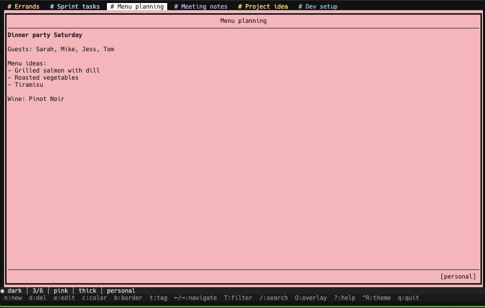
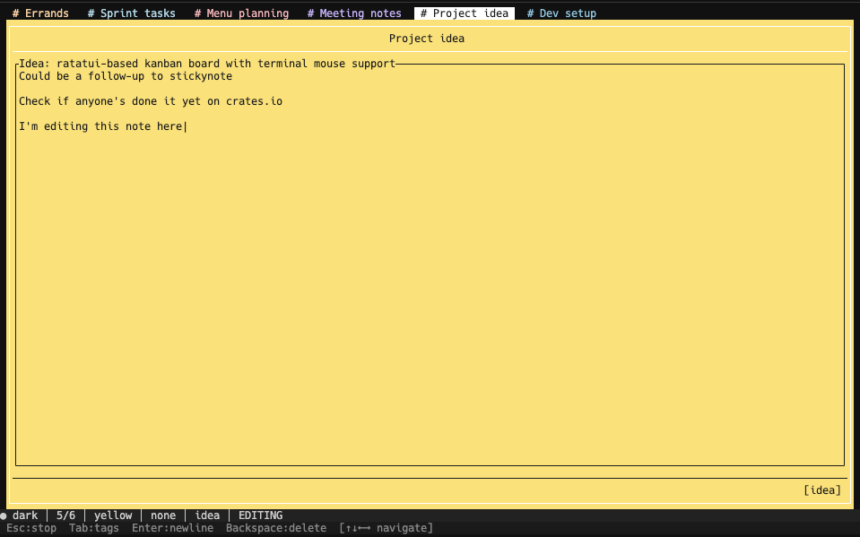
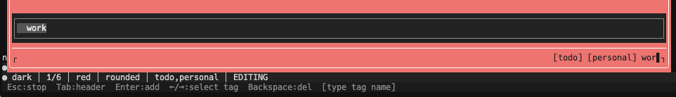
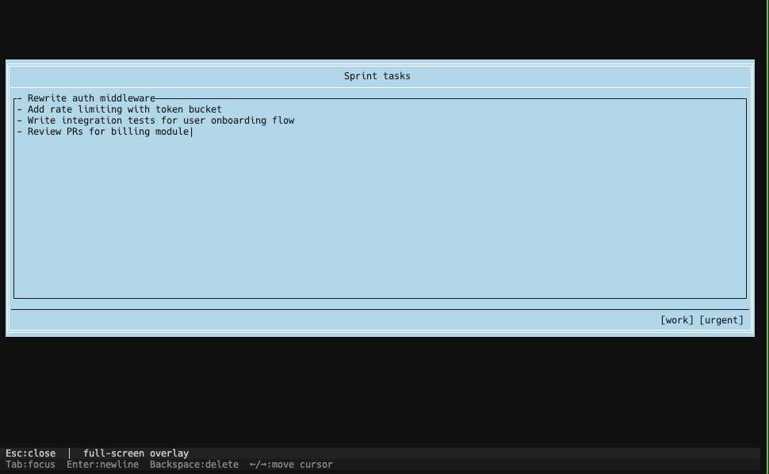
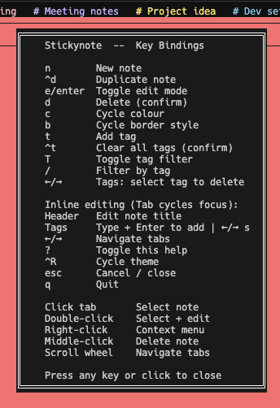
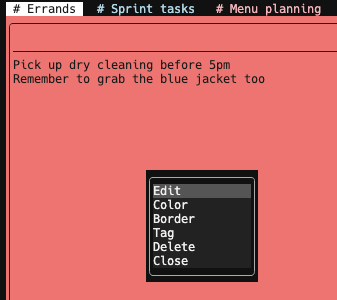

# stickynote

A sticky notes board for your terminal. Built with [Ratatui](https://ratatui.rs) and Crossterm.

I wanted a place to dump thoughts without leaving the terminal — no browser tab, no Electron app, no sync service. Just a JSON file on disk and a TUI that gets out of the way.

## What it looks like



A board with a handful of notes — the tab bar at the top, a full note card in the middle, status and hint bars at the bottom. The tab window follows the selected note; `+N` counts matching tabs omitted from the window, not filtered-out notes.



Edit mode gives each section its own focus and cursor. Tab cycles between Header → Content → Tags. The focused section gets a thick black border; single-line sections expand to fit top/bottom borders.



Tags autocomplete as you type, pulling from every tag already on the board. Tab completes a partial suggestion once; another Tab advances focus when the input already matches. Enter commits it without adding duplicates.



Overlay mode (`O`) drops the selected note full-screen when you need focus.



Help (`?`) keeps a keyboard reference handy, themed to match whatever colour scheme is active. Use `↑/↓` or the wheel to scroll, `PageUp/PageDown` to page, and `Home/End` to jump. `Esc`, `?`, or `q` closes help without quitting; other keys do not operate on the board.



Right-click a tab for quick actions: edit, change colour or border, add a tag, duplicate, or delete.

## Install

You need Rust 1.88+ (edition 2024 and the locked dependencies require it). The complete local tree passed locked tests and a release build on the checksum-verified Rust 1.88 toolchain on macOS.

The reviewed implementation passed 131 Rust tests, 36 release UI/layout tests and 7 release-helper fixtures on macOS and Linux aarch64. The Linux Rust 1.88 check also passed Clippy, formatting and a real X11/Xvfb clipboard/terminal check. CI checks locked builds/tests on Linux and macOS with Rust 1.88 and stable. Wayland and Windows runtime behavior are not verified. See [verification details](docs/VERIFICATION.md) for the tested environments and remaining limits.

### From crates.io

```bash
cargo install stickynote
```

### From Homebrew

```bash
brew install Narqulie/stickynote/stickynote
```

### From source

```bash
git clone https://github.com/narqulie/stickynote.git
cd stickynote
cargo build --release --locked
cp target/release/stickynote ~/.local/bin/
```

## Usage

```bash
stickynote
```

Press `n` to make a note, click it to select, then hit `e` to start typing.

### CLI flags

```
stickynote --board ~/work-notes.json     # use a custom board file
stickynote --theme light                 # start with light theme
stickynote --board /tmp/scratch.json --theme mono
```

### Quick capture and recovery

```bash
stickynote --board ~/work-notes.json add 'Remember the meeting' --title 'Monday' --tag work --tag todo
printf 'First line\nSecond line\n' | stickynote add --title 'From stdin' --tag inbox
stickynote --board ~/work-notes.json restore --yes
```

`add` inserts one note at the top without opening the terminal UI. Give a body argument or pipe UTF-8 stdin (invalid UTF-8 fails without writing). Tags are trimmed, lowercased and deduplicated. `--board` works before or after the subcommand. The same board validation, writer lock, external-change checks and atomic saves apply; failures exit nonzero. With no subcommand, startup remains the TUI. `--theme` is TUI-only.

`restore` **requires `--yes`** and explicitly replaces the board with its validated `.bak` copy, including when the board is corrupt or missing. Close any active writer first. It refuses a missing/invalid backup, holds the same board lock, checks for external changes, and never rotates damaged board contents into the good backup. No automatic recovery occurs.

### Keyboard

| Key | Action |
|-----|--------|
| `n` | New note (inserts at top of stack) |
| `^d` | Duplicate the selected note |
| `e` / `Enter` | Toggle edit mode |
| `d` | Delete selected note (asks for confirmation) |
| `c` | Cycle through 10 colours |
| `b` | Cycle border style: rounded → double → thick → hidden → none |
| `t` | Add a tag to selected note |
| `^t` | Clear all tags from selected note (asks for confirmation) |
| `T` | Toggle tag filter on/off |
| `/` | Filter board to notes matching a tag |
| `s` | Search title/body/tags and open a navigable jump list |
| `^Z` / `^Y` | Undo / redo board changes (normal and editing modes) |
| `[` / `]` | Move note backward/forward in the stack |
| `O` | Full-screen overlay editing |
| `E` / `^E` | Export selected note / all visible notes (normal mode) |
| `B` | Open an existing board path (normal mode; saves current work first) |
| `?` | Help overlay (scroll/page; `Esc` / `?` / `q` closes it) |
| `^S` | Save now / retry a failed save (including while editing) |
| `^R` | Cycle theme: dark → light → mono |
| `Tab` / `Shift+Tab` | Next / previous note (normal mode); cycle focus Header→Content→Tags (edit mode) |
| `←/→` / `j/k` | Navigate tabs (normal mode); move cursor (edit mode, content focus) |
| `Esc` | Cancel input / stop editing / clear tag and text filters |
| `q` / `^C` | Quit |
| `PageUp` / `PageDown` | In Content editing, move the cursor and viewport by one pane height |
| `Shift+PageUp` / `Shift+PageDown` | Extend Content selection by one pane height |
| `←/→` / `Backspace` / `Delete` | In Header/Content, move or delete whole graphemes |
| `Ctrl+←/→` | In Header/Content, move by word; Shift extends selection |
| `Ctrl+Backspace` / `Ctrl+Delete` | In Header/Content, delete to the previous/next word boundary |

### Mouse

| Action | What happens |
|--------|-------------|
| Left-click a tab | Select that note |
| Double-click a tab | Select and enter edit mode |
| Right-click a tab | Context menu (edit, colour, border, tag, delete) |
| Middle-click a tab | Delete that note |
| Right-click empty space | Context menu with "New note" |
| Click the content area | Toggle editing on the selected note |
| Scroll wheel | Cycle through matching notes; in Content editing, move the cursor vertically |
| Click left third of status bar | Cycle theme |
| Click middle third of status bar | Cycle colour |
| Click text while editing | Position the cursor in Header or Content; select an existing tag chip |
| Drag while editing | Select text in the starting Header or Content field |

### Editing

When editing a note, `Tab` cycles the focus between three sections, each with its own cursor:

- **Header** — the note title, center-justified. Type freely. `Enter` or `Down` jumps to content.
- **Content** — the body. Full text editing with line navigation (`↑/↓`), `Home`/`End`, `Enter` for newlines.
- **Tags** — inline tag management. Type + `Enter` to add, `←/→` to select existing tags, `Backspace` or `Delete` to remove them. Autocomplete pops up when you start typing. Tab completes a partial match; an exact/no-change completion advances focus. Exact matches lead the suggestions. Selected chips remain visible even when earlier chips overflow; a chip wider than the field is clipped.

`Esc` exits edit mode and clears the selection. Inline editing starts in Header; `O` starts overlay editing in Content. Both reset the cursors to the ends of their fields and share the same Tab, selection, and clipboard behavior. `q` is ordinary text while editing; Ctrl+C copies a selection in the focused field, or requests quit when there is no selection.

Long Content scrolls vertically and horizontally to keep the active cursor visible. Moving within the visible area keeps the window stable; moving outside it or resizing updates the offsets. PageUp/PageDown moves by the current pane height. Shift extends selection. Clicks and drags use the visible scroll window, so they still select the source text on screen. Editing Content does not soft-wrap; the read-only Markdown preview reflows to the pane width without changing source text.

Titles and long tag input also keep their carets visible. Tag input takes space from overflowing chips while you type; selecting a chip gives that chip priority. If the terminal has no room for the active field, it shows a resize prompt; resize before continuing text entry. Scroll offsets are session state, not saved board data. Leaving editing returns to the formatted preview at the beginning of the note.

Editing clicks use the same layout as the rendered text, including centered titles, focus borders and overlay placement. Borders, separators and footer clicks do not move the editing cursor. A drag stays within its starting field. Header and Tags ignore wheel events.

Display widths follow Ratatui's terminal-cell model. Wide glyphs occupy multiple cells, and combining sequences render together. Clicking any cell of a glyph selects its first source character; highlighting covers whole display glyphs. Left/Right (including Shift selection), Backspace and Delete operate on extended graphemes, keeping combining accents, emoji modifiers, flags and joined emoji intact. Stored offsets remain Unicode character indices. Selections expand outward to whole graphemes before copying or mutation; copied text is the exact source substring, with no normalization. Insertion also leaves the caret at a grapheme boundary if text joins adjacent clusters. Backspace in tag/search/filter/path drafts removes a whole grapheme. Terminal fonts or width policies may differ.

In Header and Content, Ctrl+Left/Right moves by runs of graphemes classified as **all whitespace**, **containing a letter/digit/underscore**, or **remaining punctuation/emoji** (a digit keycap belongs to the letter/digit group). Right consumes the current run then following whitespace; Left skips preceding whitespace then consumes the preceding run. Newlines count as whitespace, CJK letters form runs, and punctuation/emoji runs are separate from letters. Ctrl+Backspace/Delete deletes to that same boundary (or deletes the current selection); Ctrl+Shift+Left/Right extends selection. These shortcuts require the terminal to send distinct modified key events; unsupported modifiers never become text.

Terminal paste uses bracketed-paste events when supported by your terminal. Like clipboard paste (`^V`), it inserts text in the focused editing field and replaces Header/Content selections. Content preserves newlines; Header and Tags remove newlines and other control characters. Tags paste fills the input, not committed tags. Paste events outside note editing are ignored, except the export/board path prompts where non-control characters are inserted as path text. Other prompts and normal mode ignore paste; pasted `q`/`n` cannot become commands. Terminals that do not send bracketed paste cannot provide this protection.

Clipboard access failures preserve selections and text. The clipboard owner is retained while Stickynote runs. A disposable Linux aarch64 X11/Xvfb test of the reviewed implementation verified that a second process could paste copied/cut text during normal operation, board switching and undo/redo. Both boards saved correctly and terminal state restored on exit. Wayland is unverified. After exit, Linux clipboard contents may disappear without a clipboard manager; no post-exit persistence is promised.

### Undo and redo

`Ctrl+Z` undoes and `Ctrl+Y` redoes persisted board changes in normal or editing mode: text, note creation/deletion/duplication, tags, ordering, colours, borders and theme. Consecutive typing in the same field groups until a 750ms pause or another interaction; replacing a selection and each paste are separate actions. Cursor/focus/navigation changes and tag drafts are not history actions. A new persisted change discards redo; failed clipboard operations and saving do not.

Undo restores the note selection, tag/text filters, editing focus, cursors and selections from the action's snapshot, reconciles visible selection and marks the board unsaved for the ordinary checked save path. Modal help, prompts, menus and failed-quit dialogs do not accept undo/redo.

History exists only for this session. Both stacks together retain at most 100 snapshots and an estimated 8 MiB of note/state allocations; older snapshots are dropped first. Very large boards/actions can exceed the budget and have no undo/redo snapshot. History is not a backup and is never written to JSON.

### Filtering and search

`/` filters by an exact tag, case-insensitively. `s` opens a live, case-insensitive substring search over title, body and tags, including phrases spanning spaces. Text search and exact tag filtering combine with **AND**. The result list uses the same matching notes and selection as the tabs: `↑/↓` or `Tab`/`Shift+Tab` select the next/previous result, wrapping at the ends; `Enter` jumps to the selected note and keeps the query active. Reopen with `s` to revise the existing query. Type to append or use Backspace to revise it.

In the search prompt, `Esc` (or Ctrl+C) clears only the text query and closes the list, preserving the tag filter. In normal mode, `Esc` clears both filters. In `/`, `Esc` clears only the tag filter. Clearing a query retains a still-visible selection and restores ordinary matching-note navigation; query changes are not persisted and do not dirty the board.

Navigation and note actions stay within matching notes. If nothing matches, no note is selected or editable; `s` or `/` revises a filter and normal-mode `Esc` clears both. Changes to text/tags immediately reconcile membership, ending editing if the selected note no longer matches. Undo can restore that note and its previous editing state.

`n` clears both filters and selects the new note. Duplicates retain the source title/body/tags and remain in the filtered view.

### Export and board switching

In normal mode, `E` exports the selected note; `Ctrl+E` exports only the current visible notes (tag and text filters both apply), in board/tab order. Enter an output path and press Enter. A `.md` extension selects Markdown; `.txt` selects plain text. Tab cycles **by extension → Markdown → plain text → by extension**, allowing an explicit format with any filename. Markdown preserves body source; plain text removes the app's supported inline Markdown delimiters. Both include readable titles (`Untitled` for empty titles), bodies and nonempty tags. Parent directories must already exist. Exports are complete before appearing, refuse existing files/symlinks, and never edit the board or its history. Active board names are reserved even before the first save, including case and Unicode-normalization aliases on filesystems that treat them as the same name. `.bak` and `.lock` suffixes are reserved for persistence and cannot be export destinations. An error keeps the prompt open for correction; Esc cancels.

`B` opens a simple existing-board path prompt, with the active canonical path shown in the prompt and status bar (long status paths may be clipped). Paths are literal filesystem paths relative to the process working directory: no shell commands, `~` expansion or globbing. Paste can insert a path but never submits it. Enter validates/locks the destination and saves pending work before switching; a failed load, lock or save keeps the old board, its lock and unsaved work. Missing destinations are not created. Switching resets undo/redo, tag/text filters, editing, cursor/viewports and other session transients; each board retains its own notes and theme. No board registry is maintained.

### Markdown

Content supports inline formatting that renders in the note view:

- `**bold**` or `__bold__`
- `*italic*` or `_italic_`
- `~~strikethrough~~`
- `` `code` `` (amber on dark background)

Outside editing, formatting delimiters are hidden and the preview soft-wraps at word boundaries (overlong words break at graphemes). Resizing reflows the preview without changing source, history or dirty state. Reading starts at the beginning and clips rows beyond the pane; there is no separate reading-scroll state. While editing, Content shows the unwrapped literal Markdown source so the cursor, selection, and copied text refer to the characters on screen.

A click on the wrapped preview only enters ordinary inline editing: Header focus and cursors reset to the ends of their fields, just like `e`. It does **not** interpret the wrapped screen row as a source row. Subsequent editing clicks use the shared unwrapped source mapping.

### Borders

`rounded`, `double` and `thick` draw an outer card border. Legacy `hidden` hides that border while reading but shows a plain border while editing. `none` has no outer border in either mode; editing still shows the focused section's border. These stored values remain compatible with existing boards. Internal section separators remain visible.

### Themes

Three built-in themes, cycled with `^R`:

- **Dark** — dark greys, white selection border, muted hint text
- **Light** — light greys, black selection border
- **Mono** — near-black background, green accents (think old-school terminal)

## Data

Everything lives in `~/.stickynote/board.json`, or the path passed to `--board`. It's plain JSON you can read, back up, or version-control.

A missing file starts an empty board. A corrupt or unreadable file stops startup with an error and is left intact. Close Stickynote before manually editing its board. Each editing session holds an advisory lock in a persistent `.lock` sidecar; a second instance cannot open the same board. The sidecar may remain after exit. Do not delete it to bypass a running session. Board filenames ending in `.bak` or `.lock`, including Unicode case variants, are reserved for persistence. CLI capture and `B` cannot open them as editable boards. Recover using the original board path with `restore --yes`, or copy a backup to a normal board filename while closed.

Saves write and sync a temporary file in the board directory, then atomically replace the JSON. Existing file permissions are preserved. This prevents partial writes from destroying the previous board; it does not promise full power-loss durability. External changes detected before saving cancel the save rather than overwrite them.

Before replacing an existing board, a save atomically writes its previously validated bytes to `<board-path>.bak` (for example `work-notes.json.bak`). There is one backup per canonical board path: the last validated prior save, not unlimited history. The first save of a missing board has no prior file to back up. Backup failure cancels the board save. Corrupt loads do not rotate the backup, and external changes never become its source. Board bytes are checked both before backup writing and before replacement; a conflict cancels the board write. If a later board write fails, the backup can already contain the validated pre-attempt board, never partial/damaged replacement bytes. You can inspect/copy the JSON backup while the app is closed, or explicitly recover with `stickynote --board <path> restore --yes`. Recovery leaves the good backup intact. Backup writes preserve board permissions and have the same file-sync/directory-durability limitations as ordinary saves.

Persisted edits autosave after 200ms without another persisted edit (checked by the 50ms event loop). Cursor movement, selection, focus, tag-input drafts and viewports do not cause writes. The status bar distinguishes `SAVED`, `UNSAVED` and save errors; clipboard errors are separate. Failed autosaves retain pending changes and retry no more than once per second. `Ctrl+S` saves/retries immediately.

If saving fails when you quit, your changes stay in memory. Press `Enter` or `r` to retry, `Esc` to cancel quitting, or `d` followed by `y` to explicitly discard unsaved changes.

```json
{
  "notes": [
    {
      "content": "Pick up dry cleaning before 5pm",
      "title": "Errands",
      "color": "#ffcc99",
      "font_style": "normal",
      "border_style": "rounded",
      "tags": ["todo"]
    }
  ],
  "theme_idx": 0
}
```

`font_style` is retained for compatibility (`normal`, `bold`, `italic`) but has no current editing UI. Omitting it defaults to `normal`; omitting other required note data still produces a visible load error. `title` may also be omitted and defaults to empty.

To start fresh, close Stickynote first:

```bash
rm ~/.stickynote/board.json
```

## Building from source

```bash
git clone https://github.com/narqulie/stickynote.git
cd stickynote
cargo build --release --locked
```

The binary lands at `target/release/stickynote`. No special build dependencies beyond a Rust toolchain.

## Verification and releases

```bash
cargo test --locked
cargo test --release --locked ui::tests
cargo test --release --locked layout::tests
cargo clippy --locked -- -D warnings
cargo fmt --check
python3 -B -m unittest discover -s .github/scripts -p 'test_*.py'
```

Release publication is explicit: push an existing `vX.Y.Z` tag, or request that existing version through the Actions manual workflow. Ordinary branch pushes/PRs only run checks. The stable numeric tag, `Cargo.toml` version, checkout and remote tag must agree. Every destination is checked before publication: an existing crates.io package must have the same git commit and package contents, GitHub's release must use the checked tag, and a tap already at that version must match the verified source archive/checksum. Mismatches fail; rerunning a partial release skips only matching completed destinations. No version bump is inferred from adjacent commits.

The workflow requires a crates.io token restricted to this crate and `HOMEBREW_TAP_PAT` restricted to contents-write on `Narqulie/homebrew-stickynote`; those repository secret settings must be configured by a maintainer. The GitHub token has only contents-write in the release job and contents-read in CI. Action versions are pinned to upstream commit SHAs. Actual publication remains a separate maintainer action, not a local verification step.

The dependency advisory review found `lru` 0.12.5 soundness advisories (mutable iteration and panic-unsafe `pop`) and unmaintained `paste`. Ratatui's only LRU use is its layout cache (`get_or_insert`, with non-panicking `Rect`/`Layout` keys); this application does not use the affected APIs. The locked versions are retained rather than forcing an unrelated dependency migration. This is a reviewed exposure disposition, not a claim that the dependency graph is advisory-free.

## Why another notes app?

Because I wanted something that:

- Launches instantly in a terminal (no browser, no Electron)
- Survives without an internet connection
- Stores data in a format I can `grep`, `jq`, or edit with `vim`
- Has real mouse support — not bolted on, but first-class
- Looks decent without configuration

If you live in the terminal and want a scratchpad that feels like part of your workflow rather than a separate app, this might be for you.

## License

MIT
